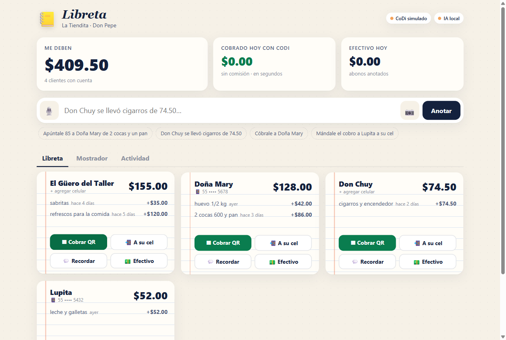
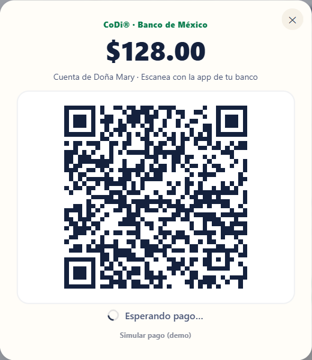
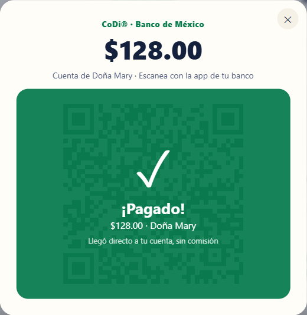
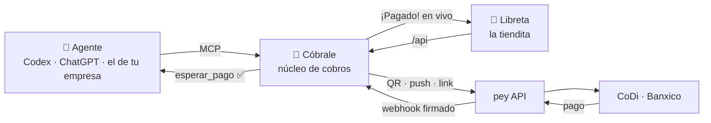
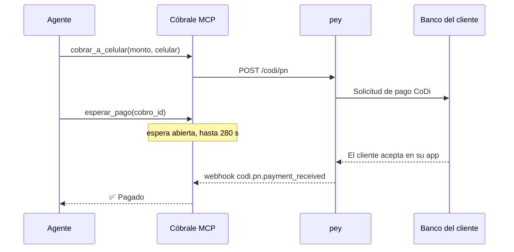

<div align="center">

# 💸 Cóbrale

### Pagos CoDi para agentes de IA

Cualquier agente cobra en México por QR, al celular o con link,<br/>
y se entera en segundos cuando le pagan. Sin comisión y sin efectivo.


[Cómo funciona](#cómo-funciona) · [Para empresas](#para-empresas-cóbrale-mcp) · [Para tienditas](#para-tienditas-libreta) · [Correr en 1 minuto](#correr-en-1-minuto) · [Equipo](#equipo)

<br/>



<table>
  <tr>
    <td align="center" width="50%"><br/><sub><b>1.</b> Se genera el cobro CoDi</sub></td>
    <td align="center" width="50%"><br/><sub><b>2.</b> El webhook de pey lo marca pagado al instante</sub></td>
  </tr>
</table>

</div>

---

## El problema

CoDi existe desde 2019: es de Banxico, es gratis y el dinero llega en segundos. Aun así casi todo se sigue cobrando en efectivo, porque integrarlo es trabajo de programador. Ni la tiendita ni la mayoría de las empresas van a integrar una API de pagos.

Pero cada vez más negocios ya tienen un agente de IA. **Cóbrale le da a ese agente las herramientas para cobrar con CoDi**, encima de la API abierta de [pey](https://docs.pey.mx).

|  | 🏢 **Empresas y developers** | 🏪 **Tienditas** |
|---|---|---|
| **Producto** | Cóbrale MCP | Libreta |
| **Cómo se usa** | Su agente (Codex, ChatGPT o el propio) llama las herramientas | Hablando o con una foto de la libreta de papel |
| **Ejemplo** | *"Cóbrale $1,250 al 55… por la factura FAC-001 y avísame cuando pague"* | *"Apúntale 85 a Doña Mary de 2 cocas y un pan"* |
| **Integración** | 5 líneas de configuración | Ninguna |

## Cómo funciona

Un solo servidor recibe el webhook de pey (solo se permite uno por API key) y avisa a todos: al agente que está esperando y a la pantalla de la tiendita.



La pieza clave es **`esperar_pago`**: convierte el webhook en algo que un agente sí puede usar. El agente crea el cobro, se queda esperando y recibe la respuesta en cuanto el cliente paga.



## Para empresas: Cóbrale MCP

```bash
npm install && npm start
codex mcp add cobrale --url http://localhost:3000/mcp
```

> *"Cóbrale $0.01 al 55XXXXXXXX por la factura FAC-001 y avísame cuando pague."*

| Herramienta | Qué hace |
|---|---|
| `cobrar_con_qr` | QR CoDi para cobro presencial. Regresa la imagen y una página `/cobro/:id` con el estado en vivo |
| `cobrar_a_celular` | Solicitud de pago directo a la app del banco del cliente (celular de 10 dígitos) |
| `crear_link_de_pago` | Link de pago de pey para mandar por WhatsApp o correo |
| `esperar_pago` | Espera a que llegue el pago (hasta 280 s por llamada) |
| `estado_del_cobro` | `pending`, `paid` o `superseded` |
| `pagos_recibidos` | Pagos de una ventana de tiempo, para conciliar |

Con la Responses API de OpenAI, el agente de cobranza de cualquier empresa se conecta así ([ejemplo completo](examples/agente-empresa/agente.js)):

```js
tools: [{
  type: "mcp",
  server_label: "cobrale",
  server_url: `${PUBLIC_URL}/mcp`,
  require_approval: "never",
}]
```

Otros clientes y configuración de Codex en [docs/codex.md](docs/codex.md).

## Para tienditas: Libreta

La libreta de papel del fiado convertida en una cuenta viva que se cobra con CoDi y se maneja hablando.

- 📷 **Foto a la libreta**: lee la letra a mano y pasa cada cuenta pendiente a limpio, ignorando lo tachado.
- 🎙️ **Dictado natural**: *"Lupita me abonó 20"*, *"Mándale el cobro a Don Chuy a su cel"*.
- ▦ **Tres formas de cobrar**: QR en el mostrador, solicitud al celular o recordatorio por WhatsApp con link de pago.
- ⚡ **Pagado en tiempo real**: llega el webhook, la cuenta queda en cero y el dinero cae directo a la cuenta del tendero.

> El fiado es crédito informal que sostiene a millones de familias, pero vive en papel, se pierde, cobrarlo da pena y casi todo se paga en efectivo. Libreta lo digitaliza sin pedirle al tendero que aprenda nada nuevo.

## Correr en 1 minuto

```bash
npm install
cp .env.example .env      # opcional: sin keys corre en modo demo
npm start                 # http://localhost:3000
```

Sin `PEY_API_KEY` ni `OPENAI_API_KEY` todo funciona en **modo demo**: CoDi simulado (botón *Simular pago*) y un parser local de frases. Con las keys, todo es real.

| Comando | Para qué |
|---|---|
| `npm run dev` | Servidor con recarga automática |
| `npm run check` | Diagnóstico real: OpenAI, QR de $0.01 en pey y webhook |
| `npm run test:mcp` | Prueba de punta a punta del MCP en modo demo |
| `npm run agente -- "…"` | Agente de empresa (requiere `PUBLIC_URL` https y `OPENAI_API_KEY`) |

<details>
<summary><b>Pasar a modo en vivo</b></summary>

1. **pey**: entra a [portal.mipey.mx](https://portal.mipey.mx), agrega una cuenta de pago (mientras se activa, pey da una de prueba) y crea una **API key** → `PEY_API_KEY`.
2. **OpenAI**: `OPENAI_API_KEY`. El modelo se elige solo según lo que tenga disponible la key, o se fija con `OPENAI_MODEL`.
3. **URL pública para el webhook**, en otra terminal:
   ```bash
   npx cloudflared tunnel --url http://localhost:3000
   ```
   Copia la URL `https://….trycloudflare.com` → `PUBLIC_URL`.
4. En el portal: **Developers → ⚙️ de tu API key → URL del webhook** = `PUBLIC_URL/webhooks/pey` → *Crear Webhook*. Copia el secreto (`whsec_…`) → `PEY_WEBHOOK_SECRET`.
5. Reinicia `npm start`. Arriba debe decir **CoDi en vivo · pey**.

`PEY_TEST_AMOUNT=0.01` hace que cada cobro real sea de un centavo, para probar sin gastar. Si el webhook no llega, la app concilia sola cada 12 s con `GET /transaction/api-key` mientras haya cobros pendientes.

**Deploy con URL fija**: cualquier host de Node con proceso persistente (Render, Railway, Fly). Build `npm install`, start `npm start`, las variables del `.env` con `PUBLIC_URL` igual a la URL del deploy, y actualizar el webhook en el portal de pey.

</details>

<details>
<summary><b>Cómo usamos la API de pey</b></summary>

| Acción | Endpoint de pey |
|---|---|
| Cobrar con QR | `POST /codi/qr` → `qrString` se dibuja como QR CoDi |
| Cobrar al celular | `POST /codi/pn` (10 dígitos) → llega a la app de su banco |
| Link de pago | `POST /payment-link/create` → checkout con CoDi o tarjeta |
| Pago recibido | Webhooks `codi.qr.payment_received`, `codi.pn.payment_received`, `payment_link.status_updated` |
| Respaldo si no llega el webhook | `GET /transaction/api-key` |

Cada cobro manda `metadata.chargeId` para asociar el pago aunque cambie el `numRef`; también se asocia por `codiQrId`, `transactionId` y `paymentLinkId`/`clientReferenceId`. Los pagos que no se pueden asociar aparecen en *Actividad* como "sin asignar" y nunca se pierden.

**Seguridad**: firma verificada con Standard Webhooks (`webhook-id`, `webhook-timestamp`, `webhook-signature`), idempotencia por `webhook-id`, token opcional para `/mcp` y un pago nunca se asocia a un cobro creado después de él. Las herramientas solo pueden *cobrar*; no hay forma de mover dinero hacia fuera.

</details>

<details>
<summary><b>Cómo usamos OpenAI</b></summary>

- **Comandos** → Structured Outputs con JSON Schema estricto y acciones `add_debt`, `cash_payment`, `charge`, `set_phone`, `sale`. Conoce a los clientes existentes, así que "doña mari" cae en "Doña Mary".
- **Foto de la libreta** → visión con el mismo esquema estricto: cliente, productos, monto y nivel de confianza por línea. El tendero revisa antes de guardar.
- **Recordatorios** → mensaje cálido y respetuoso, con el monto exacto y el link de pago.
- Si no hay internet, un parser local entiende frases simples y el demo no se cae.

</details>

## Estructura

```
src/server.js        un solo proceso: webhook, /mcp, Libreta y páginas públicas
src/pey/             cliente de pey y núcleo de cobros (webhooks, conciliación, eventos)
src/mcp/             servidor MCP con las 6 herramientas
src/libreta/         rutas, ledger del fiado y comandos en lenguaje natural
public/              interfaz de Libreta (JavaScript sin build)
examples/            agente de cobranza para empresas
docs/                conexión con clientes MCP
```

El contrato del núcleo y las convenciones del equipo están en [AGENTS.md](AGENTS.md).

## Equipo

Hecho en la Ciudad de México para el **DevDay Exchange Community Hackathon 2026** por **Diego**, **Aldo** y **Alan**.

Construido sobre [pey](https://docs.pey.mx), CoDi de Banco de México, la API de OpenAI y el [SDK de Model Context Protocol](https://github.com/modelcontextprotocol/typescript-sdk).

Licencia MIT.
